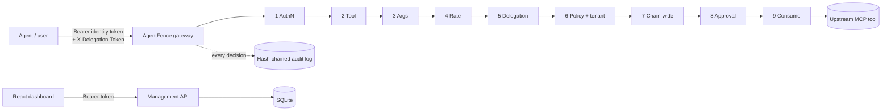
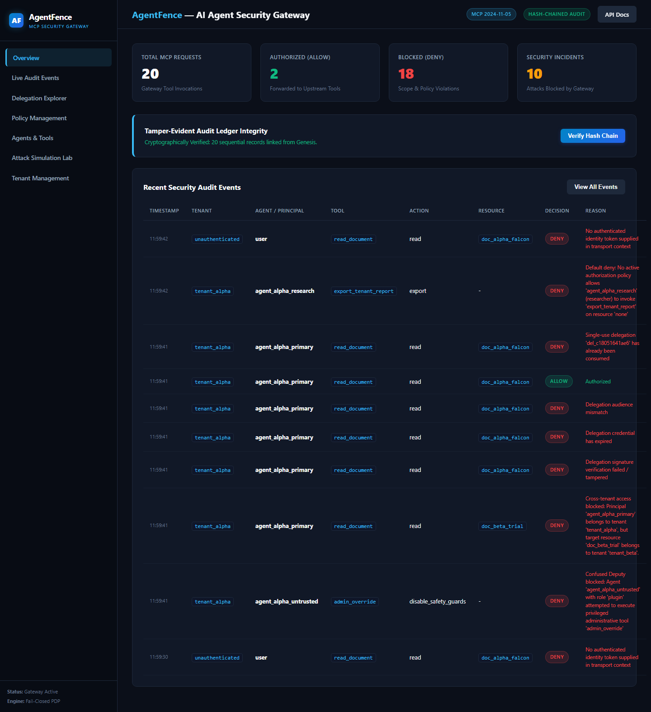
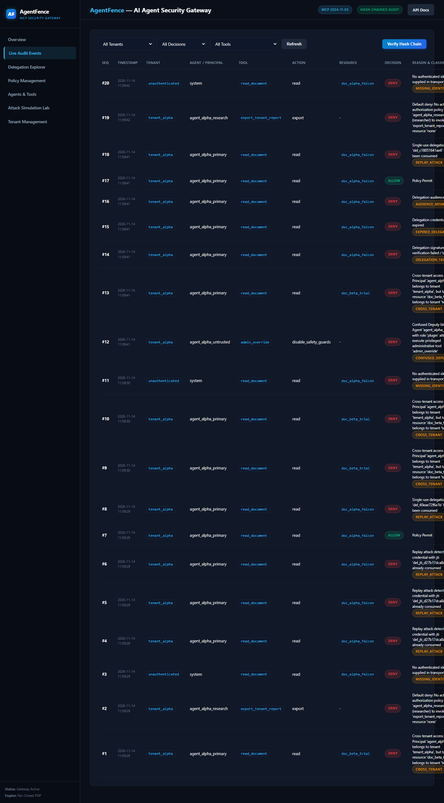
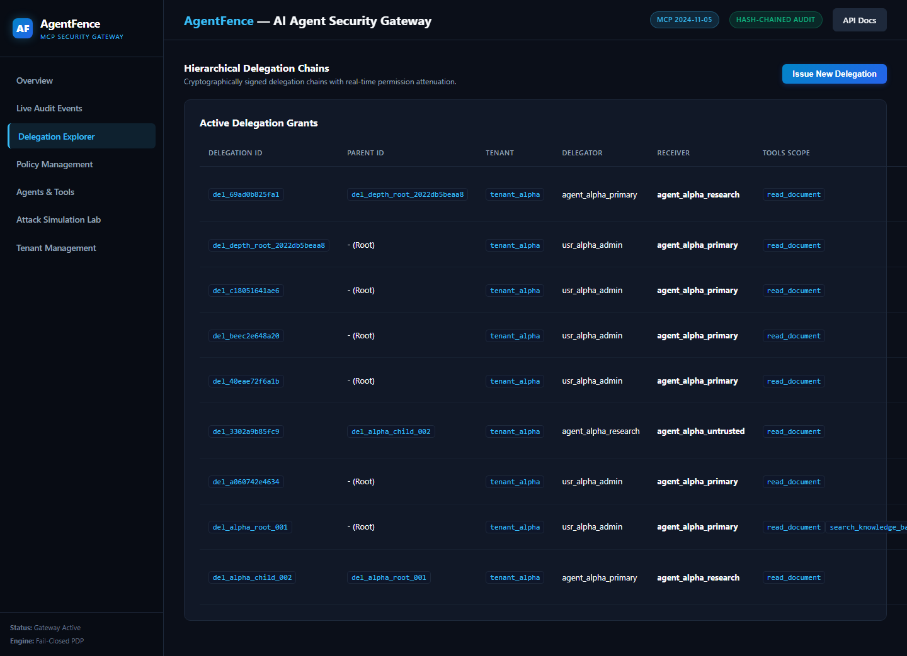
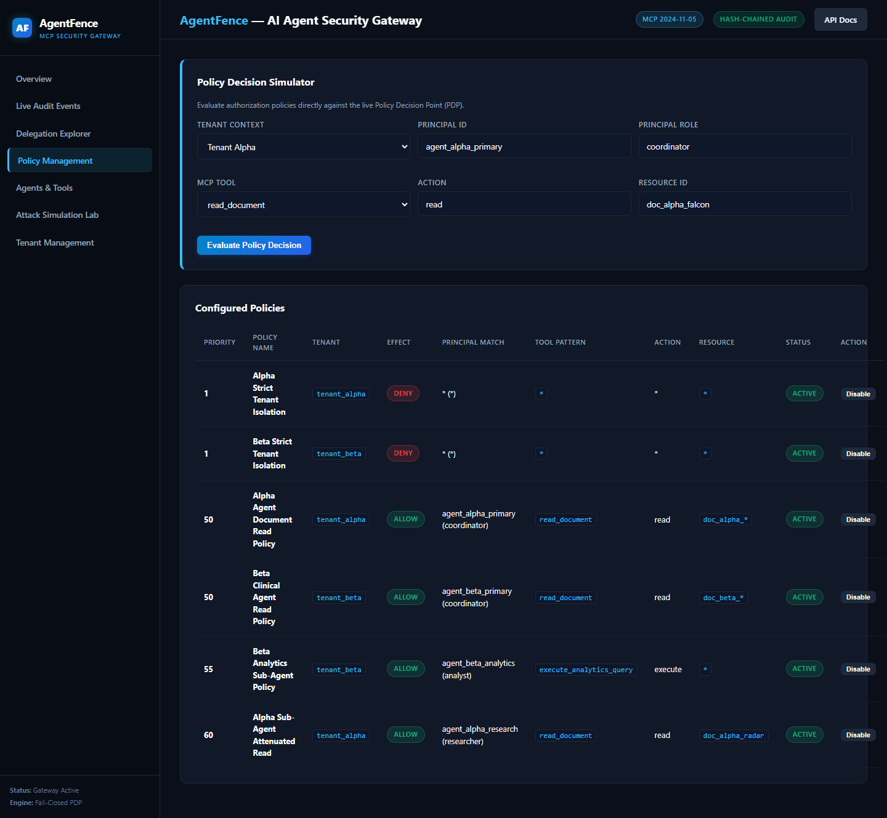
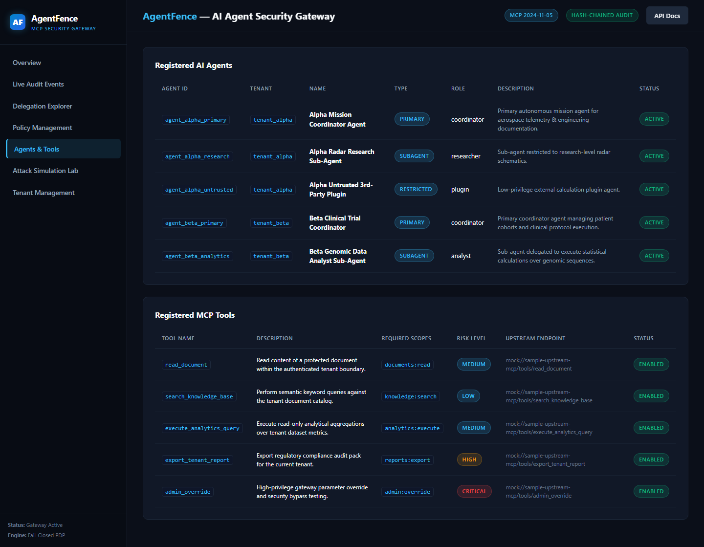
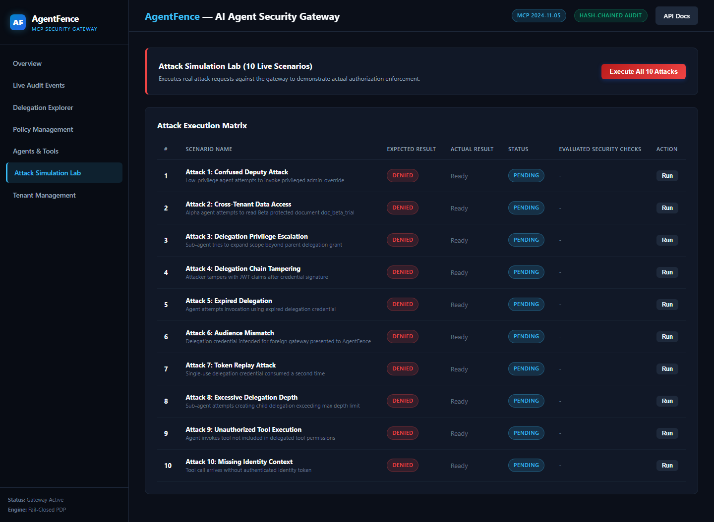
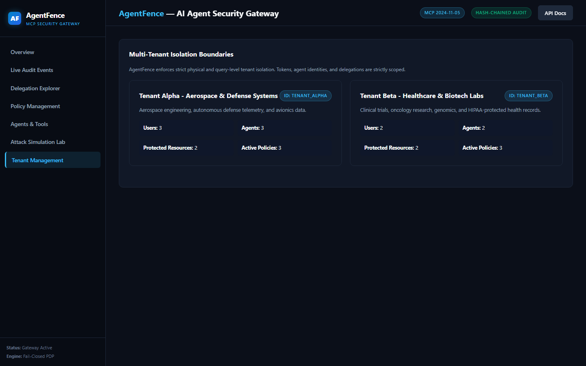

<div align="center">

# 🛡️ AgentFence
### Delegation-Aware AI Agent Security Gateway for MCP

**Authenticate agents • Enforce least privilege • Validate delegation chains • Audit every decision**


[](https://github.com/nimeshupadhyay12/AgentFence/actions/workflows/ci.yml)


[Overview](#overview) · [Pipeline](#decision-pipeline) · [Threat model](#threat-model) · [Setup](#getting-started) · [API](#api-reference) · [Attack lab](#attack-simulation-lab) · [Changes](docs/IMPROVEMENTS.md)

</div>

## Overview

**AgentFence** is a security gateway that sits between AI agents and the tools they call over the
**Model Context Protocol (MCP)**. Every `tools/call` is authenticated, checked against the caller's
delegation chain and the tenant's RBAC/ABAC policies, optionally held for human approval, and
recorded in a tamper-evident, hash-chained audit log *before* anything reaches the upstream tool.

It focuses on the problems specific to **agentic** systems: agents acting on behalf of users,
agents delegating to sub-agents, **confused-deputy** attacks, privilege escalation through
delegation, cross-tenant data access, prompt-injected tool definitions (tool poisoning), argument
smuggling and runaway agents. It is a research / portfolio prototype, not a production product
(see [Limitations](#limitations)).

## Key features

| Capability | What AgentFence does |
|---|---|
| 🔑 Authentication | Argon2id-hashed user passwords and agent client secrets; 15-minute HS256 identity tokens with `kid`, pinned algorithm, required claims, `token_use` separation and a `jti` revocation list (logout). Principal re-loaded from the DB on every request. |
| 🔐 RBAC + ABAC | Deny-overrides policy engine with conditions for delegation presence, role sets, **resource ownership**, sensitivity ceiling, tool risk level (min/max), UTC time window, delegation depth and **argument constraints**. Unknown conditions fail closed. |
| 🔗 Scoped delegation | Signed delegation credentials; root grants only by users and only for permissions they hold; agents can only narrow a grant issued to them (tools, resources, expiry, depth ≤ `MAX_DELEGATION_DEPTH`). Only a SHA-256 fingerprint is stored. |
| 🕵️ Confused-deputy defence | Chain-wide authorization: every delegator in the chain must itself be allowed to make the call. |
| 🏢 Tenant isolation | Hard rule before any policy; delegations, approvals and management API objects are tenant-scoped. |
| 🚫 Revocation & replay | Revocation cascades to descendants; single-use credentials are burned atomically via a `UNIQUE jti` row plus a conditional `UPDATE` (durable across restarts and workers). |
| 👥 Human approval | High-risk tools return `PENDING`; another administrator must approve; approvals are bound to caller + tool + exact arguments, expire, and work once. |
| 🧪 Tool guards | JSON-schema argument validation (no undeclared parameters), tool-poisoning scanner that quarantines suspicious tool definitions, per-principal/per-tool rate limits. |
| 🧱 MCP gateway | JSON-RPC 2.0 `initialize`, `ping`, `notifications/*`, `tools/list` (**filtered per caller**) and `tools/call`; in-process mock upstream by default, optional forwarding to a **real MCP server over HTTP** (allowlisted). |
| 🧾 Audit trail | SHA-256 over a canonical JSON of **every** field, chained to the previous record; logins, delegation create/reject/revoke, policy toggles, approvals, tool registration and API refusals are all logged. |
| 🎯 Attack lab | **18 live scenarios** mapped to the OWASP Top 10 for LLM Apps (2025) / API Security Top 10, each asserting the reason code of the control it targets. |
| 📊 Dashboard | React + TypeScript: login, overview, audit log, delegation explorer, policies + simulator, approvals, registry, attack lab, tenants. |

## Decision pipeline

Implemented in [`backend/app/gateway/interceptor.py`](backend/app/gateway/interceptor.py). The
first failing step denies the call; **every** outcome (allow, deny, pending) is written to the
audit chain and the upstream is only contacted in step 10.

| # | Step | Typical reason codes on failure |
|---|---|---|
| 1 | **Authenticate** the identity token: algorithm pinned, known `kid`, signature, `iss`, `aud` = this gateway, `exp`/`nbf`, `token_use=identity`, `jti` not revoked; re-load the user/agent from the DB (exists, active, same tenant). Role comes from the DB, not the token. | `AUTHN_MISSING_IDENTITY`, `TOKEN_ALGORITHM_REJECTED`, `TOKEN_SIGNATURE_INVALID`, `TOKEN_EXPIRED`, `TOKEN_REVOKED`, `PRINCIPAL_INACTIVE` |
| 2 | **Resolve the tool**: registered, enabled, not quarantined, upstream allowlisted. | `TOOL_NOT_FOUND`, `TOOL_QUARANTINED`, `TOOL_DISABLED`, `UPSTREAM_NOT_ALLOWLISTED` |
| 3 | **Validate arguments** against the tool's JSON schema. The **action** and **resource** are derived here from the tool definition, never from the caller. | `ARGUMENT_VALIDATION_FAILED` |
| 4 | **Rate limit** per principal and tool. | `RATE_LIMIT_EXCEEDED` |
| 5 | **Delegation** (if `X-Delegation-Token` is sent): signature/claims/audience, bound to the calling agent and tenant, registry record + fingerprint, not revoked/expired, single-use not consumed, depth limit, tool/action/resource scope, every ancestor valid. | `DELEGATION_TAMPERING_DETECTED`, `AGENT_IDENTITY_MISMATCH`, `DELEGATION_REVOKED`, `REPLAY_ATTACK_DETECTED`, `EXCESSIVE_DELEGATION_DEPTH`, `UNAUTHORIZED_TOOL_EXECUTION`, `RESOURCE_ACCESS_RESTRICTED`, `PARENT_DELEGATION_REVOKED` |
| 6 | **Policy decision**: hard tenant isolation, then tenant RBAC/ABAC policies, deny-overrides, default deny. | `AUTHZ_CROSS_TENANT_VIOLATION`, `AUTHZ_EXPLICIT_DENY_POLICY`, `AUTHZ_NO_MATCHING_ALLOW_POLICY` |
| 7 | **Chain-wide authorization**: each delegator in the chain (original user and every intermediate agent) must be allowed the same call. | `AUTHZ_CONFUSED_DEPUTY_BLOCKED` |
| 8 | **Human approval** for `requires_approval` tools. | `APPROVAL_REQUIRED` (PENDING), `APPROVAL_PENDING`, `APPROVAL_INVALID`, `APPROVAL_ALREADY_USED` |
| 9 | **Atomic consumption** of single-use delegations and approvals (database constraints). | `REPLAY_ATTACK_DETECTED`, `APPROVAL_ALREADY_USED` |
| 10 | **Forward** to the upstream (mock or HTTP MCP server) and audit the result. | – |



### Delegation model

* A **user** issues a root delegation to an agent of their own tenant, and only for tool/resource
  combinations the policy engine would allow that user to use directly.
* An **agent** can re-delegate only a grant issued *to it* (`parent_delegation_id`); the child must
  be a subset (tools, resources), cannot outlive the parent and cannot exceed the depth cap.
* The delegator is always the authenticated caller and the tenant is always the caller's tenant.
  Fields such as `delegating_agent_id`, `tenant_id`, `permitted_actions` and `audience` in the
  request body are ignored (and reported back as `ignored_fields`).
* A delegation credential is useless on its own: the agent must also present its own identity token,
  and the credential's `rcv_aid` must match it.

## Threat model

| Threat | Control | Demonstrated by |
|---|---|---|
| Unauthenticated tool or management calls | Mandatory identity token on `tools/*` and all of `/api/v1` except health/login; refusals audited | Attacks 10, 16 |
| Forged / tampered tokens (alg=none, leaked key, edited claims) | Pinned algorithm, `kid` key ring, required claims, signature check, legacy public secret refused at startup | Attacks 4, 12 |
| Stolen / replayed tokens | Delegations bound to the receiving agent; single-use burn; 15-min identity tokens + `jti` revocation | Attacks 7, 11; test `test_stolen_delegation_rejected` |
| Privilege escalation through delegation | Attenuation, depth cap, root grants limited to delegator's own permissions | Attacks 3, 8, 17 |
| Confused deputy | Chain-wide authorization | Attack 1 |
| Cross-tenant access | Hard tenant isolation + tenant-scoped API objects | Attack 2 |
| Excessive agency on dangerous tools | Human approval (two-person rule), deny-overrides risk policy for plugins | Attack 18 |
| Tool poisoning (prompt injection in tool metadata) | Registration-time scanner → quarantine, hidden from `tools/list` | Attack 13 |
| Argument smuggling / improper output handling | Strict JSON-schema validation, server-derived action/resource | Attack 14 |
| Unbounded consumption | Per-principal/per-tool rate limits, login throttling | Attack 15 |
| Log tampering / repudiation | Full-record hash chain, UNIQUE previous-hash (no forks), verification endpoint + CLI | Tests `test_audit_integrity_*` |
| SSRF through the tool registry | Upstream origin allowlist, checked at registration and at call time | Test `test_upstream_allowlist` |

## Getting started

Prerequisites: Python **3.12**, Node.js **20+** (CI uses 24), Git.

```bash
git clone https://github.com/nimeshupadhyay12/AgentFence.git
cd AgentFence/backend
python -m venv .venv
.venv\Scripts\activate            # Windows  (Linux/macOS: source .venv/bin/activate)
pip install -r requirements.txt
uvicorn app.main:app --host 127.0.0.1 --port 8080 --reload
```

On first start in dev mode the gateway:

* generates a random signing key in `backend/data/.dev_signing_key`;
* seeds two demo tenants plus a SecOps tenant, and writes **randomly generated** demo passwords,
  agent client secrets and the seeded delegation credentials to `backend/data/demo_credentials.json`
  (the whole `backend/data/` folder is gitignored). Set `AGENTFENCE_DEMO_PASSWORD` before the
  first start if you prefer one password for every demo principal.

Dashboard (development):

```bash
cd frontend
npm ci
npm run dev        # http://localhost:5173, proxies /api and /mcp to :8080
```

Or `npm run build` and open http://127.0.0.1:8080/ (Starlette serves `frontend/dist`). Sign in as
**`secops_admin`** (platform admin: everything, including the attack lab) or **`alpha_admin`**
(tenant admin: tenant-scoped views).

### Configuration

| Variable | Default | Purpose |
|---|---|---|
| `AGENTFENCE_ENV` | `dev` | `dev`, `test` or `prod`. In `prod` the gateway **refuses to start** without a signing key and with debug on. |
| `AGENTFENCE_SECRET_KEY` | – (random in dev) | HMAC signing key (≥ 32 bytes; the old public default is rejected). |
| `AGENTFENCE_SIGNING_KEYS` / `AGENTFENCE_ACTIVE_KID` | – | Key rotation: `k2:<new>,k1:<old>`; the first (or active) key signs, all verify. |
| `AGENTFENCE_TOKEN_EXPIRY` | `15` | Identity-token lifetime in minutes. |
| `AGENTFENCE_MAX_DEPTH` / `AGENTFENCE_MAX_DELEGATION_TTL` | `3` / `1440` | Global delegation depth and lifetime caps. |
| `AGENTFENCE_RATE_LIMIT_PER_MINUTE` / `AGENTFENCE_LOGIN_ATTEMPTS_PER_MINUTE` | `120` / `10` | Default per-tool quota and login throttling. |
| `AGENTFENCE_APPROVAL_TTL` | `30` | Approval lifetime in minutes. |
| `AGENTFENCE_UPSTREAM_ALLOWLIST` | `http://127.0.0.1:8001,http://localhost:8001` | Origins real upstream MCP servers may use. |
| `AGENTFENCE_CORS_ORIGINS` | `http://localhost:5173,http://127.0.0.1:5173` | Explicit CORS allowlist (never `*`). |
| `AGENTFENCE_DATA_DIR`, `DATABASE_URL` | `backend/data`, SQLite | Storage location. |
| `AGENTFENCE_SEED_DEMO`, `AGENTFENCE_DEMO_PASSWORD` | on in dev/test | Demo data seeding. |

## Using the gateway

```bash
# 1. log in as an agent (client-credentials) - secrets are in backend/data/demo_credentials.json
TOKEN=$(curl -s -X POST localhost:8080/api/v1/auth/login -H 'Content-Type: application/json' \
  -d '{"agent_id":"agent_alpha_research","client_secret":"<secret>"}' | jq -r .access_token)

# 2. discover the tools this caller may use
curl -s localhost:8080/mcp/v1/jsonrpc -H "Authorization: Bearer $TOKEN" \
  -d '{"jsonrpc":"2.0","id":1,"method":"tools/list"}'

# 3. call a tool under the seeded delegation del_alpha_child_002
curl -s localhost:8080/mcp/v1/jsonrpc -H "Authorization: Bearer $TOKEN" \
  -H "X-Delegation-Token: <delegations.del_alpha_child_002 from demo_credentials.json>" \
  -d '{"jsonrpc":"2.0","id":2,"method":"tools/call","params":{"name":"read_document","arguments":{"resource_id":"doc_alpha_radar"}}}'
```

Denied calls come back as MCP tool results with `isError: true`; the decision, reason code,
correlation id and audit event id are in `result._meta.agentfence`.

**High-risk tool (the `admin_override` allow path):** `alpha_admin` calls `admin_override` → `PENDING`
with an `approvalId`; `secops_admin` approves it (`POST /api/v1/approvals/{id}/decision`) or uses the
dashboard's *Approvals* page; `alpha_admin` repeats the identical call with
`params._meta.approvalId` → `ALLOW`. Self-approval, changed arguments and reuse are refused.

**Real upstream mode:** `python scripts/sample_upstream_mcp.py` starts a minimal MCP server on
`127.0.0.1:8001`; register a tool pointing at `http://127.0.0.1:8001/mcp` via `POST /api/v1/tools`
(platform admin). Authorized calls are forwarded as JSON-RPC `tools/call` without the caller's
tokens. The seeded demo tools use the in-process mock (`mock://`). stdio upstreams are not supported.

## API reference

Auth column: **public**, **auth** (any valid identity token), **tenant admin**, **platform admin**.
Interactive docs at http://127.0.0.1:8080/docs (generated from the same route table).

| Method | Path | Auth | Purpose |
|---|---|---|---|
| GET | `/api/v1/health` | public | Health |
| POST | `/api/v1/auth/login` | public | `{username,password}` or `{agent_id,client_secret}` → 15-min token (rate-limited, audited) |
| POST | `/api/v1/auth/logout` | auth | Revoke the presented token (`jti` denylist) |
| GET | `/api/v1/auth/me` | auth | Current principal |
| GET | `/api/v1/tenants`, `/api/v1/tenants/{id}` | auth | Own tenant (platform admin: all) |
| GET | `/api/v1/agents` | auth | Agents of own tenant |
| GET | `/api/v1/tools` | auth | Tool registry |
| POST | `/api/v1/tools` | platform admin | Register a tool (poisoning scan → quarantine; upstream allowlist) |
| GET | `/api/v1/delegations` | auth | Admin: tenant's grants; others: grants they issued/received/originated. **No raw tokens.** |
| POST | `/api/v1/delegations` | auth | Issue a delegation as the caller; credential returned **once** |
| POST | `/api/v1/delegations/revoke/{id}` | auth | Tenant admin, platform admin, original user or delegator; cascades to descendants |
| GET | `/api/v1/policies` | tenant admin | Policies of own tenant |
| POST | `/api/v1/policies/{id}/toggle` | tenant admin | Enable/disable (audited) |
| POST | `/api/v1/policies/simulate` | tenant admin | Dry-run the PDP (role and action looked up server-side) |
| GET | `/api/v1/approvals` | auth | Admin: tenant's approvals; others: own requests |
| POST | `/api/v1/approvals/{id}/decision` | tenant admin | `{"decision":"approve"\|"deny"}` – not your own request |
| GET | `/api/v1/audit/events` | tenant admin | Hash-chained events (tenant-scoped; filters `tool`, `decision`, `event_type`) |
| GET | `/api/v1/audit/verify` | tenant admin | Verify the whole chain |
| GET | `/api/v1/audit/export` | platform admin | JSON Lines export |
| GET | `/api/v1/metrics/overview` | tenant admin | Metrics (tenant-scoped) |
| GET | `/api/v1/simulations/catalog` | auth | Scenario catalog |
| POST | `/api/v1/simulations/run[?scenario=key]` | platform admin | Run all / one scenario |
| GET | `/api/v1/simulations/results` | platform admin | Recent results |
| POST | `/mcp/v1/jsonrpc` | identity token for `tools/*` | MCP JSON-RPC 2.0 |
| POST | `/mcp/v1/call` | identity token | REST wrapper: `{tool_name, arguments, approval_id?}` → 200 / 202 / 401 / 403 / 429 |

## Attack simulation lab

Run from the dashboard (platform admin), via `POST /api/v1/simulations/run`, or headless:

```bash
python scripts/run_simulations.py      # seeds an empty DB itself, exits non-zero on any failure (used in CI)
```

Each scenario passes only if the attack is stopped **by the control it targets** (asserted on the
reason code) and links the audit event of the decisive request.

| # | Scenario | OWASP | Expected |
|---|---|---|---|
| 1 | Confused deputy (plugin re-delegates to coordinator to read a SECRET doc) | LLM06 Excessive Agency | `AUTHZ_CONFUSED_DEPUTY_BLOCKED` (control call by the coordinator on its own grant is allowed) |
| 2 | Cross-tenant read with an unrestricted, valid delegation | LLM02 Sensitive Info Disclosure | `AUTHZ_CROSS_TENANT_VIOLATION` |
| 3 | Re-delegation adds `admin_override` | LLM06 | `DELEGATION_ATTENUATION_ESCALATION` |
| 4 | Edited delegation claims, original signature | LLM06 | `DELEGATION_TAMPERING_DETECTED` |
| 5 | Expired, genuinely signed delegation | LLM06 | `DELEGATION_EXPIRED` |
| 6 | Delegation minted for another gateway | LLM06 | `DELEGATION_AUDIENCE_MISMATCH` |
| 7 | Single-use delegation replayed | LLM06 | 1st `ALLOW`, 2nd `REPLAY_ATTACK_DETECTED` |
| 8 | Third hop on a chain capped at depth 2 | LLM06 | `DELEGATION_DEPTH_EXCEEDED` |
| 9 | Sub-agent uses its `read_document` grant for `export_tenant_report` | LLM06 | `UNAUTHORIZED_TOOL_EXECUTION` |
| 10 | No identity token | API2 Broken Authentication | `AUTHN_MISSING_IDENTITY` |
| 11 | Identity token replayed after logout | API2 | `TOKEN_REVOKED` |
| 12 | Admin token forged with alg=none and with the old public secret | API2 | `TOKEN_ALGORITHM_REJECTED`, `TOKEN_SIGNATURE_INVALID` |
| 13 | Tool description hides prompt-injection instructions | LLM01 Prompt Injection / LLM03 Supply Chain | quarantined, hidden from `tools/list`, `TOOL_QUARANTINED` |
| 14 | Undeclared parameters and path traversal in arguments | LLM05 Improper Output Handling | `ARGUMENT_VALIDATION_FAILED` |
| 15 | Runaway agent loops on a 10/min tool | LLM10 Unbounded Consumption | 10 allowed, call 11 `RATE_LIMIT_EXCEEDED` |
| 16 | Management API without a token / agent on admin endpoint | API5 Broken Function Level Authz | 401, 403 |
| 17 | Agent issues a root grant; analyst delegates a SECRET doc | LLM06 | `DELEGATOR_HAS_NO_AUTHORITY`, `DELEGATION_EXCEEDS_DELEGATOR_AUTHORITY` |
| 18 | Self-approval, pending/fabricated/changed/reused approvals on `admin_override` | LLM06 | all refused; `ALLOW` only after an independent approval |

Simulations exercise the prototype's intended protections; they are not a penetration test.

## Tests and CI

```bash
cd backend && python -m pytest -q       # 110 tests, isolated temporary database
```

GitHub Actions ([`.github/workflows/ci.yml`](.github/workflows/ci.yml)) runs the test suite, the
attack simulations on a fresh database, a check that `AGENTFENCE_ENV=prod` refuses to start
without a key, and the dashboard type-check + build.

Audit CLI: `python scripts/audit_cli.py verify | verify-legacy <archived.db> | export [tenant]`.
Databases from before v2 (11-field hash) are archived on first start, not re-chained, so the
original evidence stays verifiable with `verify-legacy`.

## Repository structure

```text
backend/app/
  api/routes.py            management API + MCP HTTP endpoints (auth decorator)
  core/                    config (fail-closed), security (tokens, Argon2id), auth, rate limiter
  delegation/engine.py     issuance, attenuation, verification, atomic replay protection
  gateway/                 interceptor (pipeline), tool_guard, tool_registry, approvals
  mcp/                     JSON-RPC server, upstream router (mock / HTTP), mock upstream
  policies/engine.py       RBAC/ABAC policy decision point
  audit/service.py         hash-chained ledger, verification, metrics
  simulations/engine.py    18 attack scenarios
backend/tests/             core, API and hardening tests
frontend/src/              React dashboard
scripts/                   run_simulations, audit_cli, sample_upstream_mcp, capture_readme_screenshots
docs/IMPROVEMENTS.md       what changed in v2 and why
```

## Screenshots

<!-- SCREENSHOTS_START -->
> Captured from the locally running AgentFence demo (v1 UI; v2 adds the login screen, Approvals page and the 18-scenario lab). Refresh with `scripts/capture_readme_screenshots.py`.

### Overview



### Live Audit Events



### Delegation Explorer



### Policy Management



### Agents & Tools



### Attack Simulation Lab



### Tenant Management


<!-- SCREENSHOTS_END -->

## Limitations

* Single-node demo: SQLite, in-process rate limiter (per worker), HS256 shared-secret tokens.
  Production would use Postgres, Redis-backed limits, asymmetric keys (RS256/EdDSA) or an external
  IdP (OIDC), TLS and secret management.
* The audit chain makes tampering *detectable*, not impossible: an attacker with DB write access
  could rebuild the whole chain. Periodically anchoring the chain head externally would fix that.
* The tool-poisoning scanner is pattern based and can be evaded; it complements, not replaces,
  review of third-party tools.
* The dashboard keeps its token in `sessionStorage` (cleared when the tab closes); an HttpOnly
  cookie with CSRF protection would be stronger.
* Upstream mode supports MCP over HTTP JSON-RPC, not stdio or SSE streaming.

## License

Released under the [MIT License](LICENSE).

## Author

**Nimesh Upadhyay** — cybersecurity student and developer ·
[GitHub](https://github.com/nimeshupadhyay12)
